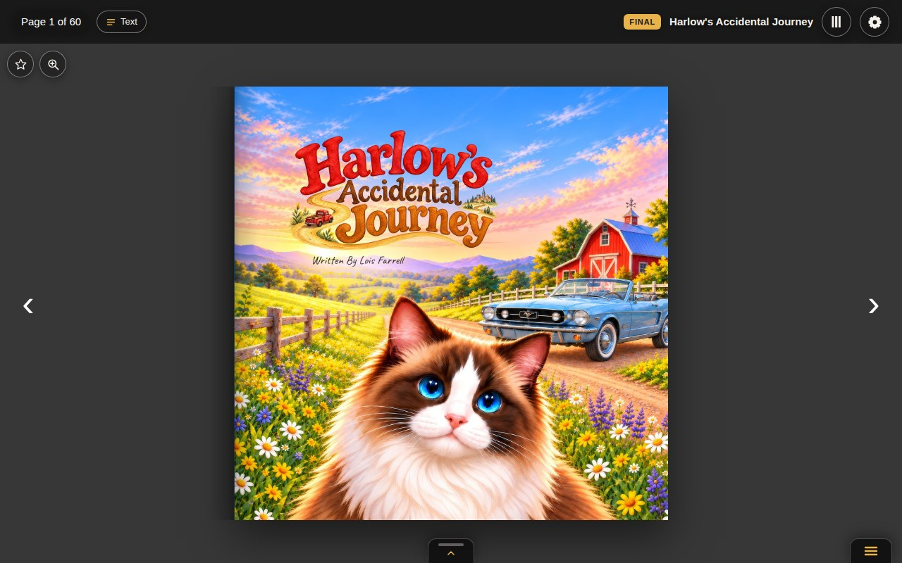
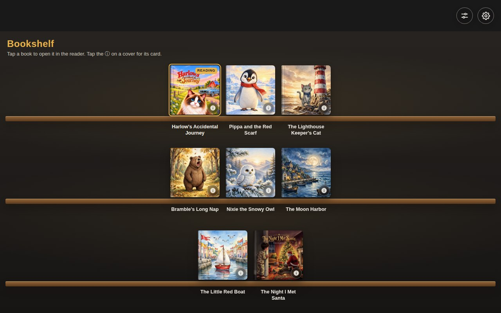
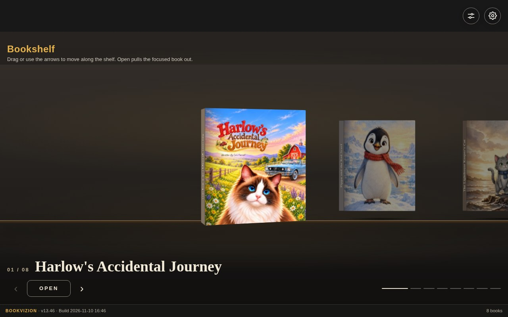
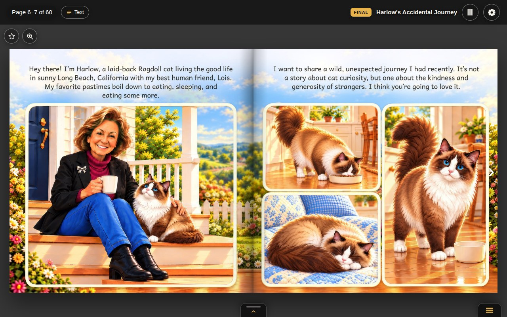
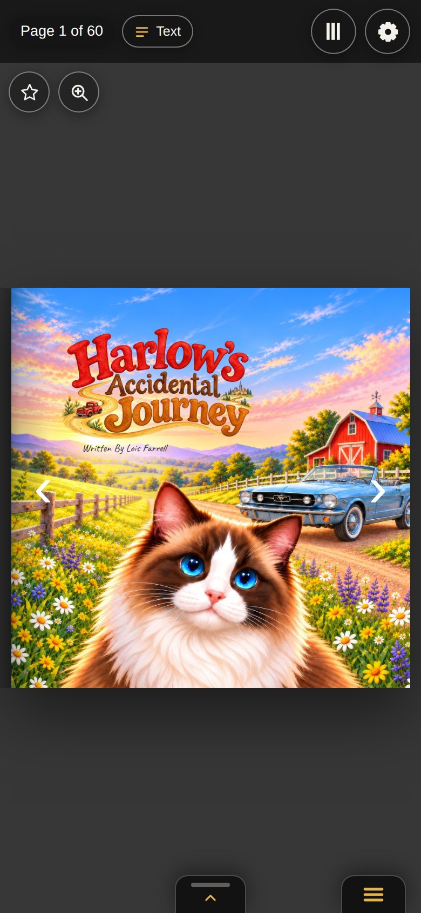

# 3D Flip BookVizon

> The BookVizion 3D flipbook viewer — a bookshelf of picture books whose covers turn like stiff board and whose pages bend like paper.

**Branch policy:** work happens on the latest *-vN / project branch. List branches before editing. Never assume the GitHub default is the working line. Working line: 3D-Flip-BookVizon-v13 (GitHub default is main). v10 is frozen as the restore point (v9, v8, v7 and v6 are frozen restore points too). `main` mirrors the v11 tip (GitHub Pages serves `main`) — the Penguin Lab feature set (bookshelf + 3D shelf, five reading modes, quick menu, in-book search, per-page text) on the shipped BEST-25d book.

[](https://mydigitalstudioz.github.io/3D-Flip-BookVizon/)


## Live preview

**https://mydigitalstudioz.github.io/3D-Flip-BookVizon/**

The viewer opens on its bookshelf: eight books — two published picture books, *Harlow's Accidental Journey* (the BEST-25d final) and *The Night I Met Santa*, plus six demo books. Pick one and it opens in the reader; a link like `#book=the-night-i-met-santa` opens that book directly. It is one static page — it runs from GitHub Pages or straight off disk by double-clicking `index.html`, with no server and no build step. Harlow's pages also ride along as data URIs in `images/pages-data.js`, loaded before the first turn, so the resident book never waits on a download mid-flip.



## Screenshots

Captured from the working viewer on `3D-Flip-BookVizon-v11`. The hero book is the BEST-25d 60-page print set. Refresh these files, and the `?v=` stamp, whenever the shots are retaken. Pages serves `main`, mirrored from the v11 shipped line.

**Bookshelf** — the front door: every book at a glance, cover and title only — the ⓘ on a cover's corner opens its info card, and a ★ count rides the cover when the book has marks.



**3D shelf** — the same library standing on a shelf: drag or step along it, and Open pulls the focused book out.



**Mid-book** — the first story spread, pages 6–7.



**Phone** — the same cover at a 390px-wide window.



## What's inside

- `index.html` — the whole viewer: bookshelf, reader, import wizard, and settings in a single static page.
- `images/` — Harlow. Sixty 1750×1750 pages from the BEST-25d print set, `manifest.js`, `pages-data.js`, and the favicon. The HTML loads them by relative path, so this folder stays beside `index.html`.
- `images/pages-data.js` — those same JPGs as data URIs, loaded before the first turn. Rebuild with `python scripts/build-pages-data.py` after a page image changes.
- `shelf/` — the other seven books' pages: *The Night I Met Santa* (36 pages) and the six demo books — Pippa and the Red Scarf (12), and five six-page minis (The Lighthouse Keeper's Cat, Bramble's Long Nap, Nixie the Snowy Owl, The Moon Harbor, The Little Red Boat).
- `vendor/pdfjs/` — pdf.js 3.11.174 (Apache-2.0) as classic scripts, vendored for the import wizard's PDF path so it also works from disk.
- `media/` — the README shots. `hero.jpg` is also the social preview.

What the viewer does:

- **Five reading modes** — Hardcover (the default 3D turn), Magazine, Swipe, Scroll, and Simple — with page layout Auto, Single, or Double. Covers turn as stiff board, slower and flat-shaded; interior pages bend like paper.
- **Two shelves, one library** — a Classic grid or a 3D shelf, with sort, cover size, a Final-editions filter, arrange mode, and hide/restore. Each book carries a status — Test, Review, Print, or Final — named on its info card and shown as a badge in the reader; the shelf itself stays clean (cover, title, and the corner ⓘ). The shelf remembers the last book you opened: its READING tag survives a reload, and Start view: Last book reopens that book.
- **Shelf dressing** — seven backdrops (Charcoal, Ambient book, Midnight, Walnut, Slate, Library, Matte Black) dress the Classic shelf and the 3D room, with a Show shelves switch and three shelf styles (Classic, Slim ledge, Library beam); the picks are remembered per device.
- **Marks** — star any spread while proofing; the shelf shows a ★ count per book, and the Pages sheet lists the marked spreads as jump chips.
- **Per-page text** — the Text button opens the open book's story text, page by page (Harlow carries its full text of record). **Read to me** speaks it with the device's en-US voices, Samantha by default, at three speeds.
- **Search** inside the open book, from the Pages sheet, with jump-to-page results.
- **Imports** — the wizard takes a folder of page images, one interior PDF, or a BookVizion book file (`.md`). Wide images and wide PDF pages split at the fold; an odd page count adds a labeled blank facing page. Imports, replaced art, settings, marks, and your place in every book are kept on this device only.
- **Proofing tools** — Replace a page's art or a whole spread, Insert pages, Compare against the original art, Trim + safety guides at the Lulu spec (safety line 0.5″ in from the 8.5″ trim), and NOT FOR PRINT on exports unless you turn it off.
- **Quick menu** — first/last page, slideshow, sound, reading mode, page layout, page labels, safety guides, and book info from one tab. **Expand view** hides the chrome for a bigger stage. **Download PDF** assembles the open book as a PDF, and every book has a **deep link** (`#book=<id>`) plus a Copy link button on its info card — the card pins its actions at the bottom and scrolls its middle when a book carries more info than fits on screen.
- **Sound** — a real recorded page turn is the default page-turn effect (a Crisp paper synth, or your own audio file, are the alternatives). Background music starts with Gymnopédie No. 1 — a real piano recording, and the default — then Prelude in C and Nocturne (also real piano recordings), a Vibraphone Lullaby, the Rainy window ambience (a real rain recording), Ocean Shore, Forest Stream, and Felt Piano, or your own audio file. Sound and music are off by default, and the two paths have separate volume sliders — Turn volume and Music volume.

## Design language

Charcoal stage, cream page paper, and one gold accent (`#e8b34b`) — the same gold as the header title, the Final badge, the mark stars, and the tabs. Controls are rectangular with a 10px corner radius everywhere in menus, panels, and the header (Text, Listen, Compare); only the round icon buttons, the covers' corner ⓘ buttons, and the peek tab's grab handle stay circular, by design. The menus — Settings, Shelf options, the quick menu, the import wizard, and the book cards — share one segmented charcoal design: every labelled group sits in its own segment block on a ground as dark as the Pages sheet, controls rest as darker insets with dark strokes, and gold marks only the current state (solid gold on small controls, a gold tint on the big shelf choices), with the quick menu's values seated in near-black chips.

The reader header names the open book in gold above the page counter — visible even with the Pages sheet open, because the sheet is a bottom sheet and never covers it. Beside the counter sit the Text, Compare, and Listen buttons when the book offers them; the status badge (Final gold, Print copper, Review steel blue, Test silver-gray) steps aside when the header gets crowded. The mark star and zoom live at the stage's top-left and stand down, with the page arrows, whenever an overlay is open.

The Pages sheet slides up from the peek tab with thumbnails, the marked-pages bar (hidden until a book has a mark), search, and page editing. The quick menu docks bottom-right in the same matte-black, gold-accented skin; Expand view docks bottom-left. A book switch never shows the previous book: the stage holds the plain backdrop with an "Opening <title>…" label until the incoming book's first spread has loaded and decoded.

## Tech stack

| Layer | Technology | Purpose |
| --- | --- | --- |
| Viewer | Single-file HTML | `index.html` is the whole bookshelf + reader |
| Page turn | WebGL leaf, two materials | Covers turn as rigid board; interior pages bend as paper |
| Script | Vanilla JS | Shelf, five reading modes, wizard, search, speech, WebAudio sound |
| Books | `images/` + `shelf/` page sets | Harlow preloaded via `pages-data.js`; the other seven load from `shelf/` |
| PDF | pdf.js 3.11.174, vendored | Renders an imported PDF into the same page list |
| Storage | localStorage + IndexedDB | Settings, place memory, marks, imports, replaced art — on-device only |
| Host | GitHub Pages | Serves `main` at the preview URL |

This viewer draws the turn itself.

## Project structure

```
├── index.html
├── .nojekyll
├── .gitignore
├── images/
│   ├── manifest.js
│   ├── pages-data.js
│   ├── favicon.png
│   └── 01-front.jpg … 60-back.jpg
├── shelf/
│   ├── santa/          (36 pages)
│   ├── pippa/          (12 pages)
│   ├── lighthouse/     (6 pages)
│   ├── bear/           (6 pages)
│   ├── owl/            (6 pages)
│   ├── harbor/         (6 pages)
│   └── boat/           (6 pages)
├── scripts/
│   └── build-pages-data.py
├── vendor/
│   └── pdfjs/
└── media/
    ├── hero.jpg
    ├── shelf.jpg
    ├── spread.jpg
    └── mobile.jpg
```

## Branches

Changes land on new branches. `main` is the published mirror, and GitHub Pages serves `main`. List branches before editing. The working line above is updated whenever it moves.

## Status

| Metric | Value |
| :--- | :--- |
| **Stack** | Static HTML · WebGL leaf · Vanilla JS · GitHub Pages |
| **Books** | 8 on the shelf — 2 published picture books + 6 demo books |
| **Preview** | 🌐 [mydigitalstudioz.github.io/3D-Flip-BookVizon](https://mydigitalstudioz.github.io/3D-Flip-BookVizon/) |
| **Status** | 🟢 Live preview |
